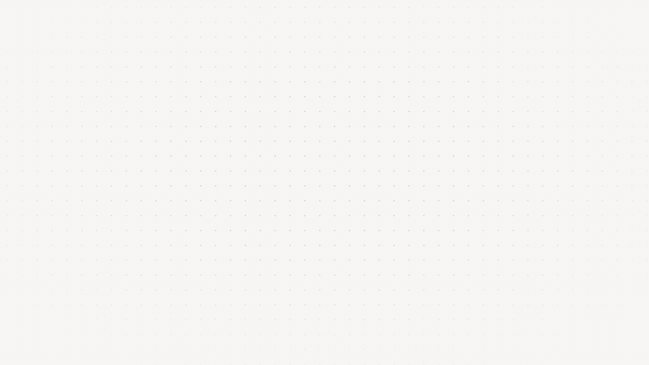

# Kōdon

**Sonner-style toast notifications for Angular**, built on [ng-primitives](https://ng-primitives.mintlify.app/).

Toasts stack, expand on hover, swipe away, and animate with CSS transitions you can interrupt.

Live demo: [kodon.kokkin.is](https://kodon.kokkin.is)

[](promo/kodon-promo.mp4)

<sub>Click for the full 1080p video.</sub>

---

## Usage

This is a copy-paste library, not an npm package. Copy the files, own the code.

### 1. Install peer dependencies

```bash
npm install ng-primitives @lucide/angular
```

### 2. Copy these files into your project

- [`toast.component.ts`](src/lib/toast.component.ts)
- [`toast.service.ts`](src/lib/toast.service.ts)
- [`provide-toast.ts`](src/lib/provide-toast.ts)
- [`toast.component.scss`](src/lib/toast.component.scss)
- [`_toast-visuals.scss`](src/lib/_toast-visuals.scss)

### 3. Wire it up

```typescript
// app.config.ts
provideKodonToast({ placement: 'bottom-end' })
```

### 4. Use it

```typescript
toast = inject(KodonToast)

this.toast.success('Changes saved')
this.toast.error('Something went wrong')
this.toast.warning('Session expiring soon')
this.toast.info('New version available')
```

### Promises

One toast follows the promise: a spinner while it runs, then success or error in the same spot.

```typescript
this.toast.promise(this.api.upload(photos), {
  loading: 'Uploading 3 photos…',
  success: n => `${n} photos uploaded`,
  error: 'Upload failed'
})
```

It returns `{ id, dismiss, unwrap }`; `unwrap()` gives you the original promise's result. If someone closes the toast while it's loading, it stays closed.

### Updating a toast

Show a toast with an id that's already on screen and that toast changes in place instead of stacking a new one. Its countdown starts over.

```typescript
this.toast.loading('Syncing 12 files…', { id: 'sync' })
this.toast.info('6 of 12 files synced', { id: 'sync' })
this.toast.success('All 12 files synced', { id: 'sync' })
```

`loading()` toasts stay until you update or dismiss them. So does any toast with `duration: Infinity`.

### Dismissing

```typescript
const { id } = this.toast.success('Saved')
this.toast.dismiss(id) // that one
this.toast.dismiss()   // all of them
```

### Per-toast options

Every method takes a second argument with `id`, `duration`, `icon` (a template) and `placement`. A number on its own is read as the duration.

---

## Configuration

```typescript
provideKodonToast({
  placement: 'bottom-end', // 'top-start' | 'top-center' | 'top-end' | 'bottom-start' | 'bottom-center' | 'bottom-end'
  duration: 5000,          // auto-dismiss time in ms
  maxToasts: 3,            // max visible at once
  gap: 14,                 // gap between expanded toasts (px)
  swipeThreshold: 100      // swipe distance before dismiss (px)
})
```

Top placements mirror bottom ones: toasts drop in from above and the stack peeks downward.

Swipe directions are auto-calculated from placement: toasts swipe toward the edges they sit against (`bottom-end` swipes down or right). Centred toasts swipe vertically toward their edge, or left and right.

On phones, bottom toasts sit above the home indicator. For that, your viewport meta needs `viewport-fit=cover`:

```html
<meta name="viewport" content="width=device-width, initial-scale=1, viewport-fit=cover">
```

---

## Customisation

The files are split on purpose. `_toast-visuals.scss` owns colors, typography, and variant styles. `toast.component.scss` owns animations, stacking, and layout. You can rework the visuals without touching the animation logic, or replace both entirely.

### Colors

Override them in your global styles, or edit the file itself:

```scss
:root {
  --kodon-toast-success-bg: hsl(142 76% 96%);
  --kodon-toast-success-border: hsl(142 76% 82%);
  --kodon-toast-success-text: hsl(142 76% 18%);
  --kodon-toast-success-icon: hsl(142 76% 36%);

  /* same pattern for error, warning, info */
}
```

### Stacking, layout, and motion

Adjust them in `toast.component.scss`:

```scss
:host {
  --kodon-toast-peek: 11px;          /* how much stacked toasts peek above each other */
  --kodon-toast-width: min(355px, calc(100vw - 32px));
  --kodon-toast-border-radius: 10px;
  --kodon-toast-duration: 350ms;
  --kodon-toast-easing: cubic-bezier(0.165, 0.84, 0.44, 1);
}
```

---

## How it works

Toasts of different heights stack cleanly. Collapsed, every toast behind the front one is drawn at the front toast's height with its content hidden, so a long message never sticks out of the stack. Its real height is kept for when the stack expands.

The animations use CSS transitions, not keyframes, so they can be interrupted mid-flight. If a new toast arrives while another is still entering, that one carries on from where it is instead of restarting.

A toast that times out slides down and away. One closed with × pops: it swells a little, then shrinks into its centre. With reduced motion, both are a plain fade.

Exit runs via the Web Animations API so the animation can complete before the DOM node is removed. A container-level pointer guard keeps the stack expanded during swipe gestures and exit animations.

Inspired by [Sonner](https://sonner.emilkowal.ski/) by Emil Kowalski and the [ng-primitives](https://ng-primitives.mintlify.app/) headless toast implementation.

---

## License

MIT © [George Kokkinis](https://kokkin.is)
